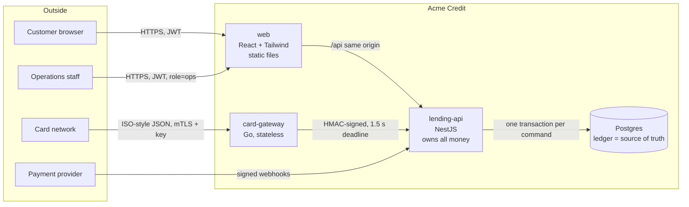
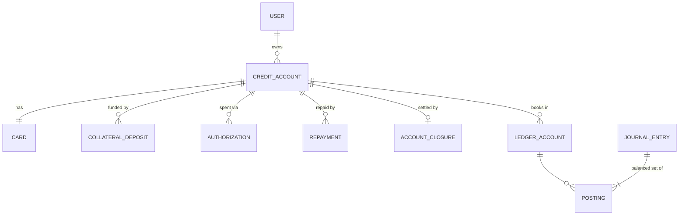

# Architecture

Acme Credit's secured card lending service: a customer deposits collateral, gets a card whose
limit is derived from it, spends, repays, and at closure gets the collateral back or sees it
applied to unpaid debt.

This document explains how the system is built and why. Individual decisions are recorded as
ADRs in [`docs/adr`](adr); the security analysis is in [THREAT_MODEL.md](THREAT_MODEL.md);
deployment and operations are in [DEPLOYMENT.md](DEPLOYMENT.md) and [RUNBOOK.md](RUNBOOK.md).

## Contents

1. [System overview](#1-system-overview)
2. [Domain model](#2-domain-model)
3. [Money and the ledger](#3-money-and-the-ledger)
4. [Concurrency](#4-concurrency)
5. [Idempotency](#5-idempotency)
6. [Consistency, events and audit](#6-consistency-events-and-audit)
7. [The card gateway](#7-the-card-gateway)
8. [Security](#8-security)
9. [Failure modes](#9-failure-modes)
10. [Observability](#10-observability)
11. [Testing strategy](#11-testing-strategy)
12. [Deployment](#12-deployment)
13. [Trade-offs and what comes next](#13-trade-offs-and-what-comes-next)

---

## 1. System overview



| Component                                    | Responsibility                                                                                                                                               | Why it exists separately                                                                                                                   |
| -------------------------------------------- | ------------------------------------------------------------------------------------------------------------------------------------------------------------ | ------------------------------------------------------------------------------------------------------------------------------------------ |
| **lending-api** (NestJS, TypeScript)         | Credit accounts, collateral, cards, authorizations, repayments, closure, the double-entry ledger, audit log, outbox, reconciliation                          | It is the **only** thing that moves money. Every balance change happens inside one Postgres transaction here.                              |
| **card-gateway** (Go, standard library only) | Card-network edge: validates network messages, rate-limits per card, enforces the authorization deadline, fails closed, compensates timeouts, circuit-breaks | Different availability, latency and scaling profile from the core. It holds **no balances**, so splitting it out adds no consistency risk. |
| **web** (React, Tailwind, TanStack Query)    | Customer app and operations console (ledger explorer, audit verification, reconciliation, concurrency lab)                                                   | Static files. In the cloud, CloudFront serves them and proxies `/api`.                                                                     |
| **Postgres 17**                              | Ledger, state, idempotency keys, audit log, outbox                                                                                                           | Real row locks, CHECK constraints, triggers and transactional DDL are what make the money invariants enforceable.                          |

**The central design choice** ([ADR 0001](adr/0001-one-service-owns-the-money.md)): the service
boundary is drawn _around_ the ledger, not _through_ it. "Spend never exceeds the limit" is a
single-row invariant enforced inside a single transaction. Had cards, ledger and accounts been
separate services, that invariant would need a distributed protocol (2PC or a saga with
compensation) on the hottest path in the system. Inside lending-api, the code is a modular
monolith (`collateral`, `cards`, `authorizations`, `repayments`, `closure`, `ledger`, `events`,
`ops`) with clear module seams, so pieces can be extracted later if scale ever demands it.

## 2. Domain model



### State machines

Every status column has its transitions enforced in code, with CHECK constraints tying the
status to the fields it implies (for example, `CAPTURED` ⇔ `captured_amount` and
`journal_entry_id` present).

| Entity             | States                                                                                       |
| ------------------ | -------------------------------------------------------------------------------------------- |
| Credit account     | `PENDING_COLLATERAL → ACTIVE → CLOSED` (one open account per customer: partial unique index) |
| Card               | `INACTIVE → ACTIVE ⇄ FROZEN → CLOSED`                                                        |
| Collateral deposit | `PENDING → CONFIRMED \| FAILED \| REJECTED`                                                  |
| Authorization      | `HELD → CAPTURED \| REVERSED \| EXPIRED`, or `DECLINED` at birth                             |
| Repayment          | `PENDING → SETTLED \| FAILED \| REJECTED`                                                    |

### Lifecycle

```mermaid
sequenceDiagram
    autonumber
    actor Cu as Customer
    participant API as lending-api
    participant PP as Payment provider
    participant GW as card-gateway
    participant CN as Card network

    Cu->>API: POST /credit-accounts (Idempotency-Key)
    API-->>Cu: PENDING_COLLATERAL, card INACTIVE
    Cu->>API: POST /collateral-deposits {amount}
    API-->>Cu: payment instructions (reference)
    Cu->>PP: bank transfer
    PP->>API: webhook payment.succeeded (signed)
    Note over API: ledger: DR collateral cash / CR collateral held<br/>limit = collateral × advance rate<br/>account ACTIVE, card ACTIVE
    CN->>GW: authorize {card_token, amount}
    GW->>API: POST /network/authorizations (HMAC)
    Note over API: lock account row → check available → hold
    API-->>GW: approved
    GW-->>CN: 00
    CN->>GW: capture
    GW->>API: capture → ledger: DR card receivable / CR merchant payable
    Cu->>API: POST /repayments → PP → webhook
    Note over API: DR operating cash / CR card receivable (+ refund payable if overpaid)
    Cu->>API: POST /closure
    Note over API: debt covered by overpayments, then collateral;<br/>the rest is returned. Books for the customer end at exactly 0.
```

**Credit limit** = confirmed collateral × `ADVANCE_RATE_BPS` (default 10,000 bps = 100%, so
collateral always covers the limit). Basis-point maths rounds toward zero, so the limit can
never exceed what the collateral supports. A new confirmed deposit raises the limit.

**Available credit** = limit − outstanding balance − open holds. The database guarantees it is
never negative: `CHECK (outstanding_balance + held_amount <= credit_limit)`.

**Collateral is only counted once the provider confirms the funds** (signed webhook), never when
the customer says they sent it.

## 3. Money and the ledger

See [ADR 0002](adr/0002-double-entry-ledger-in-postgres.md).

### Representation

- Every amount is an **integer number of minor units** (cents) in a `bigint` column, a
  TypeScript `bigint` inside a `Money` value object, and an `int64` in Go. There are no floats
  anywhere money is held; a lint rule bans `parseFloat` in both TypeScript apps.
- Over JSON, amounts are **strings** (`{"amount": "12500", "currency": "USD"}`), because
  JavaScript numbers lose precision above 2^53. The web client parses user input like
  `$1,250.07` straight into `125007n` and formats with `Intl.NumberFormat` from exact decimal
  strings.
- Currency is carried with every amount; operations on mismatched currencies throw. Only USD
  is enabled today, but nothing assumes it.

### Double-entry

Every money movement is a **journal entry** whose postings (debits and credits) sum to zero.
Balances are derived from postings; the cached `ledger_accounts.balance` exists for speed and is
maintained only by a trigger.

| Account            | Kind                                                                 | Scope              |
| ------------------ | -------------------------------------------------------------------- | ------------------ |
| `COLLATERAL_HELD`  | liability: collateral we owe the customer                            | per credit account |
| `CARD_RECEIVABLE`  | asset: what the customer owes                                        | per credit account |
| `REFUND_PAYABLE`   | liability: overpayments we owe back                                  | per credit account |
| `COLLATERAL_CASH`  | asset: segregated cash backing all collateral                        | system             |
| `OPERATING_CASH`   | asset: company cash (may go negative: settlement precedes repayment) | system             |
| `MERCHANT_PAYABLE` | liability: owed to the network for captured purchases                | system             |
| `FEE_INCOME`       | revenue                                                              | system             |
| `CREDIT_LOSS`      | expense: written-off balances                                        | system             |

| Event                                                | Debit                           | Credit                                            |
| ---------------------------------------------------- | ------------------------------- | ------------------------------------------------- |
| Collateral confirmed                                 | Collateral cash                 | Collateral held                                   |
| Purchase captured                                    | Card receivable                 | Merchant payable                                  |
| Repayment settled                                    | Operating cash                  | Card receivable (+ Refund payable for any excess) |
| Closure: overpayment applied                         | Refund payable                  | Card receivable                                   |
| Closure: collateral applied                          | Collateral held; Operating cash | Card receivable; Collateral cash                  |
| Closure: shortfall written off (ops charge-off only) | Credit loss                     | Card receivable                                   |
| Closure: collateral returned                         | Collateral held                 | Collateral cash                                   |
| Closure: overpayment returned                        | Refund payable                  | Operating cash                                    |

Authorization **holds are not ledger entries**: a hold is a reservation against the limit, not a
movement of money. It lives in `credit_accounts.held_amount` and becomes a ledger entry only when
captured. This matches how card issuers book authorizations and keeps the ledger free of
churn from reversed or expired holds.

### Invariants enforced by the database

The application is careful, but the database does not trust it:

| Guard                                   | Mechanism                                                                                                               |
| --------------------------------------- | ----------------------------------------------------------------------------------------------------------------------- |
| Entries balance                         | Deferred constraint trigger `journal_entries_balanced`: at commit, debits = credits (error `LG001`)                     |
| Ledger is append-only                   | Triggers forbid `UPDATE`/`DELETE`/`TRUNCATE` on entries and postings (`LG002`). Corrections are new, reversing entries. |
| Posting currency matches the account    | `LG003`                                                                                                                 |
| No posting into an old entry            | Postings must be written in the transaction that created their entry (`created_xid xid8`, `LG004`)                      |
| Cached balances can't be edited by hand | `ledger_accounts_guard`: balance changes only from inside the posting trigger (`pg_trigger_depth`)                      |
| No overdrawn customer accounts          | `CHECK (allow_negative OR balance >= 0)`                                                                                |
| Spend ≤ limit                           | `credit_accounts_within_limit` CHECK                                                                                    |
| Closure settles every cent              | `account_closures_debt_settled` CHECK (refund + collateral applied + written off = debt)                                |
| Audit log tamper-evidence               | `audit_log_guard`: rows are immutable except for the one-time seal                                                      |

The posting trigger locks ledger accounts with `FOR NO KEY UPDATE` in account-id order, so two
entries touching the same accounts cannot deadlock on each other.

### Reconciliation

A reconciliation job (hourly, and on demand from the ops console) re-derives everything from
first principles in one `REPEATABLE READ, READ ONLY` snapshot, so concurrent traffic can never
cause a false alarm:

1. `ledger_trial_balance`: debit-normal balances equal credit-normal balances.
2. `ledger_balance_drift`: every cached balance equals the sum of its postings.
3. `outstanding_matches_ledger`: each account's outstanding balance equals its card receivable.
4. `holds_match_authorizations`: held amount equals the sum of open holds.
5. `limit_matches_collateral`: limit equals confirmed collateral × advance rate.
6. `collateral_segregation`: segregated collateral cash equals total collateral owed.
7. `audit_chain_intact`: the audit hash chain recomputes.
8. `outbox_flowing`: no event has waited more than 5 minutes.

A failure logs `reconciliation found discrepancies`, sets the `reconciliation_failed_checks`
metric, and pages on-call through a CloudWatch alarm ([RUNBOOK](RUNBOOK.md#reconciliation-failed)).

## 4. Concurrency

See [ADR 0003](adr/0003-pessimistic-locking-per-credit-account.md).

**The credit account row is the serialization point for all money on that account.** Every
command that changes money (authorize, capture, reverse, expire, settle a deposit or
repayment, freeze, close) starts with `SELECT … FROM credit_accounts WHERE id = $1 FOR UPDATE`
and reads everything else under that lock. Two purchases racing for the last dollar are
processed one after the other; the second one sees the first one's hold.

Lock order is always **credit account → entity row (deposit, authorization, repayment) →
ledger accounts (sorted by id)**, so lock-ordering deadlocks can't happen. Transactions run at
`READ COMMITTED` (correct under explicit row locks) and are retried automatically on
serialization failures and deadlocks (`40001`, `40P01`), with a metric counting retries.

**Why pessimistic, not optimistic.** Contention is per account and concentrated (a customer, or
a card-testing attack, firing many requests at one card). Optimistic concurrency would turn
contention into retry storms exactly when latency matters most. A row lock queues them in
order, and holds are short (a few ms).

**Per-account queue.** The k6 load test found that row locking alone is not enough. Twenty-five
concurrent requests for one hot card each checked out a pool connection and sat waiting on the
lock. A pool of 20 was exhausted, and every other customer's authorization queued behind one
card (gateway p95: 7 ms → 536 ms). The fix is a `KeyedSerializer`: same-account hot-path work
queues **in memory** before taking a connection, so a process holds at most one connection per
account. The database lock still provides correctness across processes; the queue only provides
fairness. Beyond `ACCOUNT_QUEUE_MAX_DEPTH` (100) queued requests, the API sheds load with a 503,
which the gateway treats as fail-closed.

| Same load test (gateway traffic + 25 workers on one card) | Before    | After            |
| --------------------------------------------------------- | --------- | ---------------- |
| Gateway authorization p95                                 | 536 ms    | 7 ms (p99 14 ms) |
| Hot card p95                                              | 845 ms    | 64 ms            |
| Throughput                                                | 122 req/s | 405 req/s        |

**Proof** (all automated):

- Integration and E2E: 100 simultaneous purchases against $500 with $7 each approve exactly
  71, never 72.
- Property-based tests (fast-check) post random sequences of journal entries and check that
  cached balances always match an independent model and the books always balance. They also
  check that money arithmetic is exact and that closure settlement conserves every cent for any
  balances.
- The ops console's _Concurrency lab_ demonstrates it live.

## 5. Idempotency

See [ADR 0004](adr/0004-idempotency-in-the-same-transaction.md).

Retries are normal (mobile networks, gateway retries, provider redeliveries); applying money
twice is not acceptable. Every money-moving entry point is idempotent, and the record that
makes it idempotent is written **in the same transaction as the effect**:

```
BEGIN
  INSERT INTO idempotency_keys (scope, key, request_hash) … ON CONFLICT DO NOTHING
  ├─ inserted     → do the work, store the response, COMMIT (both or neither)
  └─ conflict     → the earlier transaction committed: replay its stored response
                    (a concurrent duplicate waits on the unique index until the first commits)
```

| Entry point                                  | Key                                                               | Duplicate behaviour                                                                                                    |
| -------------------------------------------- | ----------------------------------------------------------------- | ---------------------------------------------------------------------------------------------------------------------- |
| Customer POSTs (open, deposit, repay, close) | `Idempotency-Key` header (required), scoped to caller + operation | Same response replayed with `Idempotent-Replayed: true`; same key with a different body → `422 IDEMPOTENCY_KEY_REUSED` |
| Card authorizations                          | network transaction id                                            | Original decision returned (approved or declined); same id, different purchase → `94`                                  |
| Capture / reversal                           | state-based                                                       | Re-capturing the same amount or re-reversing returns the current state                                                 |
| Payment webhooks                             | provider event id (`webhook_events`)                              | `200 {duplicate: true}`, no effect; a new event id for an already-settled payment → `ALREADY_SETTLED`                  |
| Freeze / unfreeze                            | state-based                                                       | Freezing a frozen card is a no-op                                                                                      |

The web client generates one key per user _intent_ and reuses it for retries and double-clicks,
rotating it only after success. Mutations are never retried automatically.

## 6. Consistency, events and audit

See [ADR 0005](adr/0005-transactional-outbox-and-hash-chained-audit.md).

- **Transactional outbox.** Domain events (`CollateralDepositConfirmed`,
  `AuthorizationApproved`, `CreditAccountClosed`…) are inserted into `outbox_events` in the same
  transaction as the change, so there is no dual write. A relay publishes them at-least-once
  (`FOR UPDATE SKIP LOCKED`, so replicas share the work; exponential backoff on failure). The
  event id doubles as the consumer's deduplication key. The publisher is an interface; locally it
  logs, and in production it would be EventBridge, SNS or Kafka.
- **Audit log.** Every state change writes an audit row (actor, action, entity, request id,
  data) in the same transaction. A sealer job then links new rows into a **SHA-256 hash chain**
  (`hash = sha256(prev_hash ‖ position ‖ canonical entry)`) under an advisory lock. Rows are
  immutable except for the one-time seal (trigger), so editing or deleting any row breaks the
  chain at that point. `GET /v1/ops/audit/verify` and reconciliation recompute it. The ledger
  itself is the financial audit trail; the audit log adds _who_ and _why_.
- **Request context.** `AsyncLocalStorage` carries the request id and actor through every
  layer, so logs, audit rows and events of one request correlate. The gateway propagates
  `X-Request-Id` to the API.

## 7. The card gateway

See [ADR 0006](adr/0006-fail-closed-gateway-with-compensation.md).

Card networks expect an answer within a hard deadline; a late "yes" is worse than an on-time
"no". The gateway (Go, standard library only, distroless image):

- **Validates** network messages strictly (sizes, formats, unknown fields), so malformed traffic
  never reaches the core and gets code `30`.
- **Rate-limits per card** (token bucket, 30/min, burst 10) against card-testing attacks
  (code `65`).
- **Signs** every call to the API with HMAC over `timestamp, method, path, body`.
  A cross-language test checks the Go signer against vectors produced by the TypeScript
  verifier.
- **Fails closed.** If the API does not answer within 1.5 s, the gateway declines with `91`.
  Because the API might still approve after the deadline, it **enqueues a compensating
  reversal**: a worker replays the identical (idempotent) request and reverses the hold if it
  was approved. A **stand-in memory** keeps answering `91` if the network retransmits that
  transaction, so the customer is never told "approved" for a hold being reversed.
- **Circuit breaker.** After 5 consecutive failures it declines instantly for a cool-down, then
  lets one probe through.
- **Maps decisions to ISO 8583-style codes**: `00` approved, `51` insufficient funds, `62`
  frozen, `46` closed, `54` expired, `78` not yet active, `14` unknown card, `94` duplicate,
  `91` issuer unavailable.

Verified in a live drill: with the API paused mid-request, the gateway declined in 1.55 s, the
late approval was found and reversed, and no hold remained.

## 8. Security

Full analysis: [THREAT_MODEL.md](THREAT_MODEL.md). Summary:

- **Authentication.** ES256 JWTs from a simulated identity provider (the brief allows one),
  with issuer and audience pinned and short TTLs. In production the keys come from Secrets
  Manager; a real deployment would verify a real IdP's JWKS instead.
- **Authorization.** A global guard denies by default; routes opt out with `@Public()` or require
  `@Roles('ops')`. Every resource is loaded through `findAccessible(principal, id)`. Another
  customer's account returns **404, not 403**, so existence is not leaked. Charge-off is
  ops-only.
- **Machine-to-machine.** The gateway signs requests to the API (HMAC + timestamp, method
  and path bound). Webhooks carry Stripe-style signatures with a 5-minute freshness window and
  are deduplicated. The card network authenticates to the gateway with mutual TLS plus a key.
- **Input.** DTO whitelisting (`forbidNonWhitelisted`), amounts as regex-validated strings,
  zod-validated configuration (the process refuses to start misconfigured, and refuses sandbox
  endpoints in production). Request bodies are size-limited.
- **Data.** Card PANs are never stored; only a network token and last4. Logs redact tokens and
  authorization headers. Postgres is encrypted at rest (KMS) and in transit (`verify-full`).
- **Abuse.** Rate limits per IP (strict on sign-in), per card at the gateway, and WAF
  rate-based rules at the edge.
- **Web.** Strict CSP with no inline scripts, `frame-ancestors 'none'`, HSTS, and a
  same-origin API, so tokens never cross origins.

## 9. Failure modes

| Failure                                                  | Behaviour                                                                                                             | Money impact                                                             |
| -------------------------------------------------------- | --------------------------------------------------------------------------------------------------------------------- | ------------------------------------------------------------------------ |
| API slow or down during an authorization                 | Gateway declines `91` within 1.5 s; compensating reversal if the API approved late; breaker opens on repeated failure | None: no hold survives a declined authorization                          |
| Process crash mid-command                                | Postgres rolls back the transaction                                                                                   | None: effect, idempotency record and event commit together or not at all |
| Client retries, network duplicates, webhook redelivery   | Idempotency replays the original result                                                                               | None                                                                     |
| Webhook for the wrong amount, or for a closed account    | Payment `REJECTED` and flagged for manual refund; the account is not partially credited                               | None                                                                     |
| Two requests race on one account                         | Serialized by the row lock (and the per-account queue)                                                                | None                                                                     |
| Hold never captured                                      | Expiry sweep releases it after `AUTH_HOLD_TTL_MINUTES`                                                                | Credit restored                                                          |
| Repayment arrives after the debt shrank (double payment) | Excess booked to `REFUND_PAYABLE`, returned at closure                                                                | None: no money lost                                                      |
| Event publisher down                                     | Outbox keeps events; relay retries with backoff; reconciliation flags a lag over 5 minutes                            | None                                                                     |
| Database failover (Multi-AZ)                             | ~1–2 minutes of errors; in-flight transactions roll back; clients retry idempotently                                  | None                                                                     |
| Bug or tampering changes a stored number                 | Reconciliation fails the matching check and pages                                                                     | Detected within the hour                                                 |
| Gateway restarts with reversals queued                   | Queue drains on graceful shutdown (60 s stop timeout); anything left is logged for manual review and alarms           | Possible stray hold until expiry, never a lost payment                   |

## 10. Observability

- **Logs:** structured JSON (pino, slog) with request id, actor and route, and never secrets,
  tokens or PANs.
- **Metrics** (Prometheus at `/metrics`):
  - `http_request_duration_seconds` (labelled by route template, never by raw URL)
  - `card_authorization_decisions_total{outcome,reason}`
  - `card_authorization_duration_seconds`
  - `payment_webhooks_total`
  - `db_transaction_retries_total`
  - `outbox_pending_events`
  - `outbox_oldest_pending_seconds`
  - `reconciliation_failed_checks`

  The gateway exposes `expvar` counters: decisions by code, breaker state, rate-limited
  requests, compensations.

- **Health:** `/health` (liveness) and `/ready` (database reachable); the gateway has `/healthz`
  and `/readyz`, which stays ready with the breaker open, because declining is correct
  behaviour.
- **Alarms (Terraform):**
  - reconciliation failure;
  - a timeout reversal that needs manual review;
  - unhandled API errors;
  - authorization p99 latency;
  - 5xx rate;
  - healthy task count;
  - database CPU, storage, connections and replica lag.

## 11. Testing strategy

| Layer                        | What                                                                                                                                                                    | Where                                                                     |
| ---------------------------- | ----------------------------------------------------------------------------------------------------------------------------------------------------------------------- | ------------------------------------------------------------------------- |
| Unit (Jest, Vitest, Go)      | Money maths, state machines, settlement planning, signatures, breaker, rate limiter, keyed serializer, client money parsing                                             | `*.spec.ts`, `*.test.ts`, `*_test.go`                                     |
| Property-based (fast-check)  | Money arithmetic is exact; random ledger postings keep cached balances equal to a model and the books balanced; closure conserves every cent                            | `money.spec.ts`, `ledger.property.int-spec.ts`, `settlement-plan.spec.ts` |
| Integration (Testcontainers) | Every flow against real Postgres, including DB triggers firing on tampering, concurrency races, idempotency races and audit tampering in isolated databases             | `*.int-spec.ts`                                                           |
| Go race detector             | Gateway under `-race`, repeated runs                                                                                                                                    | `make test-go`                                                            |
| End-to-end                   | 40 tests against the full Docker stack: lifecycle through the real gateway, closure with debt, idempotency, 100-way concurrency, security boundaries, then books checks | `e2e/`                                                                    |
| Load (k6)                    | Steady gateway traffic plus a contended hot card; thresholds on p95/p99 and fail-closed rate; reconciliation must pass afterwards                                       | `load/`                                                                   |
| Static                       | ESLint (money lint rule), tsc strict, gofmt/vet, Terraform validate, Trivy                                                                                              | CI                                                                        |

## 12. Deployment

AWS, defined in [`infra/terraform`](../infra/terraform) and described in
[DEPLOYMENT.md](DEPLOYMENT.md). See [ADR 0007](adr/0007-aws-ecs-fargate-and-rds.md).

```mermaid
flowchart TB
    U[Customers] --> CF[CloudFront + WAF]
    CF -- static --> S3[(S3 web bucket)]
    CF -- /api/* + secret header --> ALB1[API ALB<br/>CloudFront-only]
    NET[Card network] -- mTLS --> ALB2[Network ALB<br/>trust store]
    subgraph VPC[VPC across 3 AZs]
        subgraph Private subnets
            API[lending-api<br/>ECS Fargate ×3+]
            GW[card-gateway<br/>ECS Fargate ×3+]
            MIG[migrate task<br/>per deploy]
        end
        subgraph Data subnets, no internet route
            RDS[(RDS Postgres 17<br/>Multi-AZ, KMS)]
        end
    end
    ALB1 --> API
    ALB2 --> GW
    GW -- Service Connect --> API
    API --> RDS
    MIG --> RDS
    SM[Secrets Manager + KMS] -.-> API & GW
```

## 13. Trade-offs and what comes next

**Deliberate trade-offs**

- **One database for the money.** It simplifies correctness enormously. The cost is a vertical
  scaling ceiling, but a large Postgres instance handles thousands of authorizations per second
  when locks are per account. Next steps if needed: read replicas for ops queries, then
  sharding by credit account id, which is already the natural partition key.
- **Pessimistic locks and a per-account queue.** They give strict ordering and simple
  reasoning. The cost is that one account's throughput is bounded by lock hold time
  (~1–5 ms → hundreds of authorizations per second per card, far above any real card).
- **Holds outside the ledger.** It matches issuer practice and keeps the ledger meaningful.
  The cost is that reconciliation must check holds separately (it does).
- **Simulated IdP, payment provider and card network.** They are part of the brief. The seams
  are real: JWT verification, signed webhooks, the signed gateway protocol and mTLS at the
  edge.
- **In-memory compensation queue in the gateway.** It is simple and survives graceful
  restarts. A hard crash could leave a stray hold until it expires (default 7 days), and it is
  logged and alarmed. In production this queue would be durable (SQS).
- **Gateway rate limits are per process.** That is acceptable as card-testing mitigation;
  with many replicas the effective limit scales with replica count. A shared limiter (Redis)
  would make it exact.

**Not built (yet), roughly in priority order**

1. Statements, minimum payments, due dates and late fees (`FEE_INCOME` exists in the chart of
   accounts).
2. A real event bus behind the outbox, with consumers (notifications, credit-bureau reporting).
3. A durable compensation queue for the gateway; a reverse-by-network-transaction-id endpoint
   to avoid approve-then-reverse when the API was fully down.
4. A retention policy for idempotency keys and webhook records (partition by month, drop after
   the provider's retry window), and partitioning for the audit log and postings.
5. A real IdP (OIDC) with MFA for operations staff, and four-eyes approval for charge-offs.
6. Interest accrual, and limit decreases on partial collateral withdrawal.
7. Multi-currency (the model supports it; FX and per-currency system accounts are the work).
